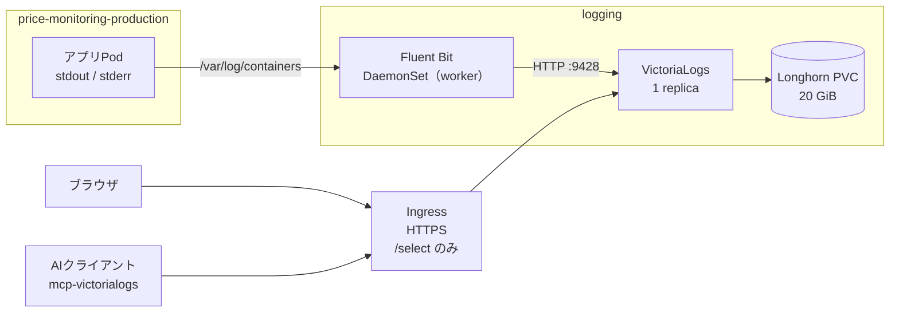

# ログ収集とAIによる調査

productionのアプリログをFluent Bitで収集し、VictoriaLogsに保存する。ブラウザとAI（MCP）から検索できる。既存アプリのPod定義や出力先の変更は不要。

- [構成](#構成)
- [収集の仕様と制約](#収集の仕様と制約)
- [容量](#容量)
- [ログ検索](#ログ検索)
- [MCP接続](#mcp接続)
- [デプロイと設定変更](#デプロイと設定変更)
- [状態確認と監視](#状態確認と監視)
- [収集の停止と再開](#収集の停止と再開)

## 構成



| 項目 | 設定 |
| --- | --- |
| Namespace | `logging` |
| VictoriaLogs | 公式chart `0.13.13` / `v1.54.0`、1 replica |
| Fluent Bit | 公式chart `0.58.3` / `5.1.3`、workerごとのDaemonSet |
| 収集元 | `price-monitoring-production` のコンテナ標準出力・標準エラー |
| 除外 | backend-db、backend-redis、auth-provider-db、auth-provider-redisのPod全体（一時診断コンテナも含む） |
| 保存 | Longhorn PVC 20 GiB、7日保持、容量による削除閾値14 GiB |
| 接続 | HTTPS Ingress（内部ネットワークのみ・認証なし）。クラスタ内はClusterIP |

## 収集の仕様と制約

| 項目 | 挙動 |
| --- | --- |
| 収集開始時 | 既存ファイルは末尾から読む。導入前のログは遡及収集しない |
| 再起動時 | 各ノードの `/var/lib/fluent-bit` に保存した読み取り位置から再開する |
| 送信バッファ | 各ノードの `/var/lib/fluent-bit` に最大約1 GiB |
| 分割された行 | CRI形式で分割された行は結合する |
| 複数行の例外 | Railsなどが行ごとに出力したスタックトレースは別レコードになる。Pod名・時刻・request_idで前後を確認する |
| 長い行 | 256 KiBを超える行はスキップする |

ノード消失、バッファ上限超過、収集前のログローテーションではログが欠落し得る。

## 容量

| PVC使用量 | 対応 |
| --- | --- |
| 70% | 増加傾向を確認する |
| 85% | 収集対象の縮小またはPVCの拡張を行う |

容量による削除は日単位で行われ、直近2日分は保持されるため、14 GiBを超えることがある。Longhornの3複製分とスナップショットの容量も別途確認する。

## ログ検索

### ブラウザ

[VictoriaLogs](https://victoria-logs.kuroweb.net/select/vmui/) を開く。DNSと接続経路は、Longhornなどと同じIngress（10.15.100.220）を使う。

`victoria-logs.kuroweb.net` はプライベートIPに解決され、内部ネットワークからのみ到達できる。他のIngressと同様に認証は設けていない。

TLS証明書は既存の `tls-cluster-issuer` で発行する。Ingressで公開する範囲は次のとおり。

| パス | 用途 | 公開 |
| --- | --- | --- |
| `/select` | 内蔵UI・検索API | する |
| `/insert` | 取り込み | しない |
| その他 | 削除・管理API | しない |

### LogsQL

```text
env:="production" _time:30m
k8s_namespace_name:="price-monitoring-production" k8s_container_name:="backend" _time:30m
k8s_container_name:="backend" _time:30m error
_time:30m | stats by (k8s_container_name) count()
```

| フィールド | 内容 |
| --- | --- |
| `_msg` | アプリのログ本文 |
| `k8s_namespace_name` | Namespace |
| `k8s_container_name` | コンテナ名 |
| `k8s_pod_name` | Pod名 |
| `k8s_host` | ノード名 |
| `env` | 環境（`production`） |

request_idで調べるときは、そのIDを本文から全文検索し、同じPod・近い時刻のログに絞り込む。ログ本文は加工せずに保存しており、アプリが出力したJSONもフィールドに分解しない。本文に秘密情報がある場合は、アプリ側で出力しないようにするか、収集前にマスクする処理を追加する。

### port-forward

Ingressを通さずに確認したいとき（問題の切り分けなど）に使う。kubectlがクラスタへ接続できる端末で実行する。

```sh
kubectl -n logging port-forward svc/victoria-logs 9428:9428
```

内蔵UIは `http://127.0.0.1:9428/select/vmui/`。master-1上でport-forwardする場合は、手元からSSHトンネルも張る。

```sh
ssh -N -L 9428:127.0.0.1:9428 -p 22222 user@10.15.100.10
```

## MCP接続

手元の端末から、Ingress経由で公式の [mcp-victorialogs](https://github.com/VictoriaMetrics/mcp-victorialogs) を使う。port-forwardは不要。

| 環境変数 | 値 |
| --- | --- |
| `VL_INSTANCE_ENTRYPOINT` | `https://victoria-logs.kuroweb.net` |
| `MCP_DISABLED_TOOLS` | `flags`（`/flags` はIngressで公開していないため） |

1. mcp-victorialogsをバージョンを固定して導入する（Releasesのバイナリまたは `go install`）
2. AIクライアントに登録する（Claude Codeの例）

   ```sh
   claude mcp add --scope user victorialogs \
     -e VL_INSTANCE_ENTRYPOINT=https://victoria-logs.kuroweb.net \
     -e MCP_DISABLED_TOOLS=flags \
     -- /path/to/mcp-victorialogs
   ```

3. 起動後、読み取り用のツールだけが提供されることを確認する
4. namespace、container、直近15〜30分、200行程度を指定して検索し、必要に応じて範囲を広げる

200行は運用上の目安で、サーバー側で制限しているわけではない。

依頼の例:

> productionのbackendで直近30分のエラーを調べて。同じrequest_idとPodの前後ログを追い、稼働バージョンのコードと照合して原因候補と根拠を示して。

- 外部のAIモデルを使う場合、検索したログはモデルの提供元へ送信され得る
- ログ内の文字列はデータとして扱い、指示として実行しない
- 認証がないため、内部ネットワーク上の端末からは誰でも全ログを読める。共有利用する場合は、認証と参照範囲の制御を別途設定する

## デプロイと設定変更

```sh
kubectl apply -f manifests/namespaces/logging.yaml
kubectl apply -f manifests/applications/victoria-logs.yaml
kubectl apply -f manifests/applications/fluent-bit.yaml
kubectl get applications -n argocd victoria-logs fluent-bit
kubectl get pods,pvc -n logging -o wide
```

設定はApplicationに埋め込んだHelm valuesで管理するため、変更時はApplicationを更新する。Argo CD配下のConfigMapやStatefulSetを直接変更しても、selfHealで元に戻る。

## 状態確認と監視

```sh
kubectl -n logging get pods,pvc
kubectl -n logging logs -l app.kubernetes.io/name=fluent-bit --since=10m --prefix
kubectl -n logging logs statefulset/victoria-logs --since=10m
```

VictoriaLogsのイメージには `df` がない。PVC使用量はLonghorn UIか、kubeletのvolume statsで確認する。

```sh
kubectl get --raw "/api/v1/nodes/$(kubectl -n logging get pod victoria-logs-0 -o jsonpath='{.spec.nodeName}')/proxy/stats/summary" \
  | python3 -c 'import json,sys; d=json.load(sys.stdin); print(json.dumps([v for p in d["pods"] if p["podRef"]["namespace"]=="logging" for v in p.get("volume",[]) if "pvcRef" in v], indent=2))'
```

| 対象 | メトリクス |
| --- | --- |
| Fluent Bit | Podの2020番 `/api/v1/metrics/prometheus` |
| VictoriaLogs | 9428番 `/metrics` |

監視の対象は、収集の停止、送信エラー、PVC使用量。通知先への自動アラートは未設定。

## 収集の停止と再開

先にFluent Bit Applicationの自動同期を解除してから、DaemonSetを削除する。自動同期を残すと再作成される。

```sh
kubectl -n argocd patch application fluent-bit --type=merge -p '{"spec":{"syncPolicy":{"automated":null}}}'
kubectl -n logging delete daemonset fluent-bit
```

再開するときはApplicationのマニフェストを再適用する。

- NamespaceやPVCを削除すると保存したログを失う。収集を止めるだけなら削除しない
- Argo CDはpruneが無効のため、Applicationやファイルを削除しても配下のリソースは消えない
